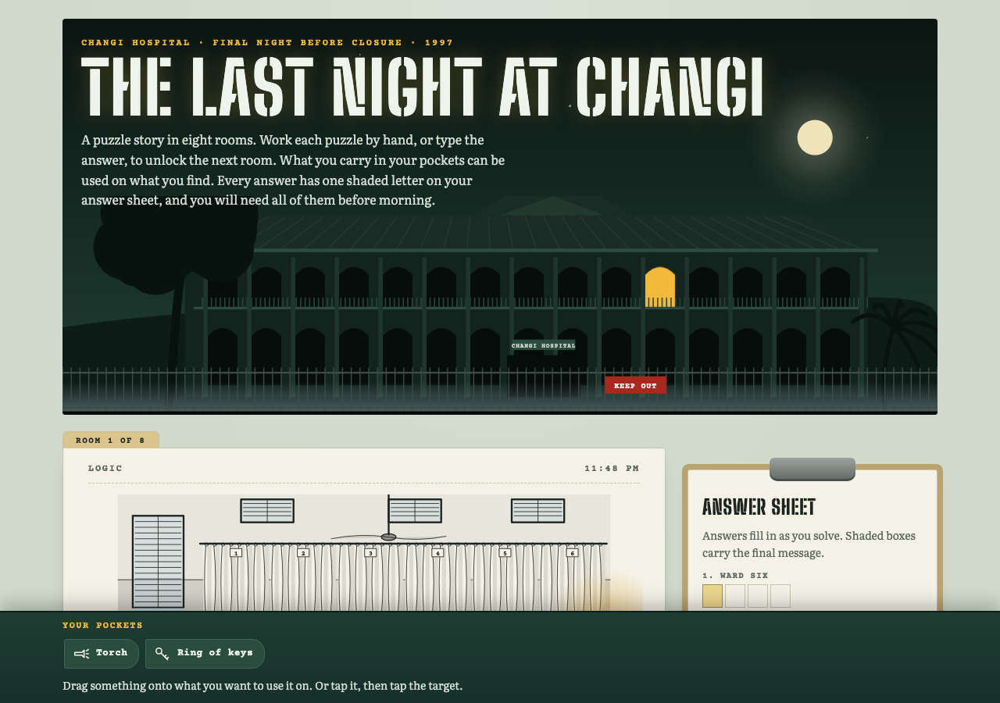
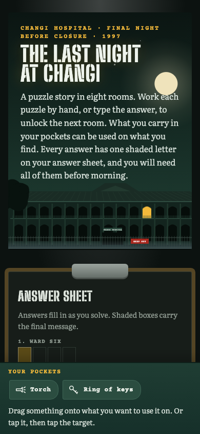

# The Last Night at Changi

**[▶ Play it in your browser](https://fang89.github.io/last-night-at-changi/)** · one HTML file · desktop and phone · light and dark mode · about 45–60 minutes

> *Changi Hospital closes at seven tomorrow morning. Someone has to sit the final night with the building. The roster says Nurse Ellis: three months qualified, and junior enough that nobody thought to ask.*

It is 1997, the last patients went to the new hospital this afternoon, and the power to Ward Six was cut at ten. The ceiling fans are still turning. Sister Hartley's handover report lists six patients. The admissions book you closed yourself at six o'clock lists five.

You have a torch, a ring of spare keys and eight rooms to lock before morning.

---

## What's inside

**Eight rooms, eight kinds of puzzle.** Each room is a manila case note with an ink-wash drawing of the scene, a page of story and one puzzle. No puzzle type repeats.

| Time | Room | Puzzle |
|---|---|---|
| 11:48 PM | Ward Six | Logic: seat six patients in six beds from four clues |
| 12:06 AM | Records Room | Cipher: an old-fashioned pigpen code with its key in the file |
| 12:31 AM | Mortuary | Riddle and a letter lock you turn wheel by wheel |
| 12:52 AM | The Tin | A message hidden in a nurse's night notes |
| 1:10 AM | Nurses' Station | A pager message and a 1990s phone keypad |
| 1:24 AM | East Corridor | A path across the floor tiles |
| 1:40 AM | Operating Theatre | A prescription and a cabinet of unlabelled drawers |
| 1:58 AM | The Theatre Clock | Count back through the night's timings and set the clock |

**You solve with your hands.** Drag patients into beds, turn the lock wheels, ring letters with your finger, tap out a reply on the keypad, hop the tiles, pull the drawers, drag the clock hands. If you've already worked it out in your head, you can type the answer instead.

**Your pockets matter.** You start with a torch and keys and pick up more as you go. Some rooms are too dark to read until you shine the torch on them. Some things are locked. One item you find early is only used at the very end.

**Every answer is the next room's door.** Each answer leads the story into the next room, and the story opens with that word, so you know you got it right.

**A final puzzle.** Every answer has one shaded box on your clipboard answer sheet. Read in order, the shaded letters spell the last thing you need before morning.

**It gets to you quietly.** This is a ghost story for adults: no jump scares, no spooky rhymes. The feeling comes from objects: a cut hospital bracelet, a warm pillow, an empty cup. The ending changes how you read everything before it.

**Stuck?** Each room has two hints. The first gives you a nudge and the second almost gives the answer away.

**Nothing to spoil.** Rooms 2 to 8 are encrypted in the page using the answer to the room before, so you can't skip ahead with View Source, and the answers aren't stored in it either. Progress is saved in your browser, so you can close the tab and come back.

---

## How it was made

It started from the puzzle books of **Nomis Piy**: a short scene, a puzzle, and an answer that unlocks the next page. The goal was to bring that format to a browser and set it somewhere real in Singapore.

**1. Choose a place and a deadline.** Old Changi Hospital is one of Singapore's best-known ghost stories, and setting the game on its *last night* gives it a built-in clock and a reason for the player to be alone. Period details give it the atmosphere: louvred windows, ceiling fans, pagers, probationer nurses.

**2. Write the ending first.** The final message was chosen before any puzzle. Then each room's answer had to do two jobs: move the story forward *and* contain the right letter for the final message. The answers were picked to fit both.

**3. Choose puzzles people enjoy.** The eight puzzle types follow roughly how escape-room players rank them: logic and ciphers first, maths last. Playtesting cut two early ideas. Morse code was a chore, and a Caesar shift was "very tedious to shift every alphabet back". The rule from then on: **visual matching and one aha moment, never mechanical decoding.** About eight symbols to decode, not a paragraph.

**4. Write the story with restraint.** One protagonist with a job to do, one mysterious patient whose needs drive every room, and one twist at the end. The story leaves the emotions unspoken and lets objects carry them.

**5. Draw every room.** All nine scenes are hand-written SVG in an ink-wash style, with a lamp glow, moonlight through louvres and a torch beam. In dark mode the same drawings turn into moonlit, blueprint-like night scenes. The corridor uses a one-point perspective helper for its floor tiles and arches.

**6. Make the build prove every puzzle.** The build script won't produce the page unless:
- the logic puzzle has **exactly one** solution (it tries every arrangement of the beds)
- all 26 cipher symbols are different
- the lock wheels can spell the answer and *don't* start on it
- the hidden message, the keypad digits, the tile path and the drawer lookups each spell their answer
- the clock arithmetic comes out right
- the shaded letters spell the final message

**7. Play it with robots.** A headless browser plays the whole game four ways: by clicking, by drag-and-drop only, with real touch input on a phone-sized screen, and by reloading halfway to check that progress and opened doors are kept. It also checks for page errors and sideways scrolling. Every drawing is screenshotted in light and dark mode and looked at by eye, because layout bugs only show up visually. That's how a stray grey shape in the records room and a moon glow cut off at the picture's edge were caught.

**8. Fix the leaks.** The early drawings gave answers away: an open drawer in the theatre picture showed the letter you needed. Those were redrawn. Item names are encrypted too, so even "what you'll pick up later" doesn't show in the source.

The game was built with [Claude Code](https://claude.com/claude-code). The game engine (encrypted rooms, the answer sheet, pockets and locked panels, and eight reusable puzzle widgets) was written so the next puzzle story can reuse it.

---

## Play

**https://fang89.github.io/last-night-at-changi/**

Or download `index.html` and open it. It needs nothing else apart from Google Fonts.

*A work of fiction inspired by the stories told about Old Changi Hospital. The real buildings are closed and fenced off; please enjoy them from here.*
